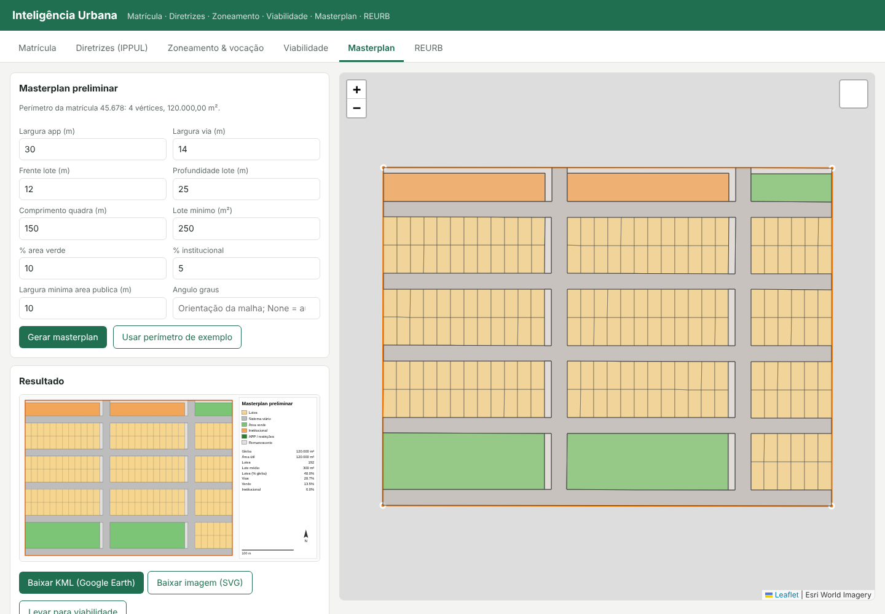
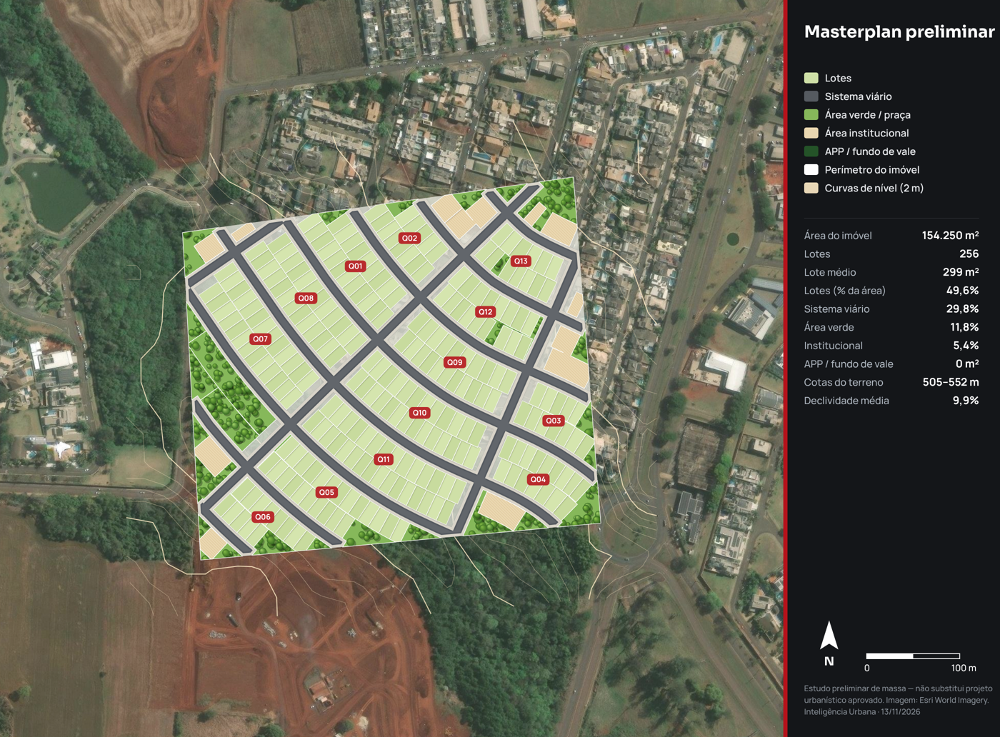
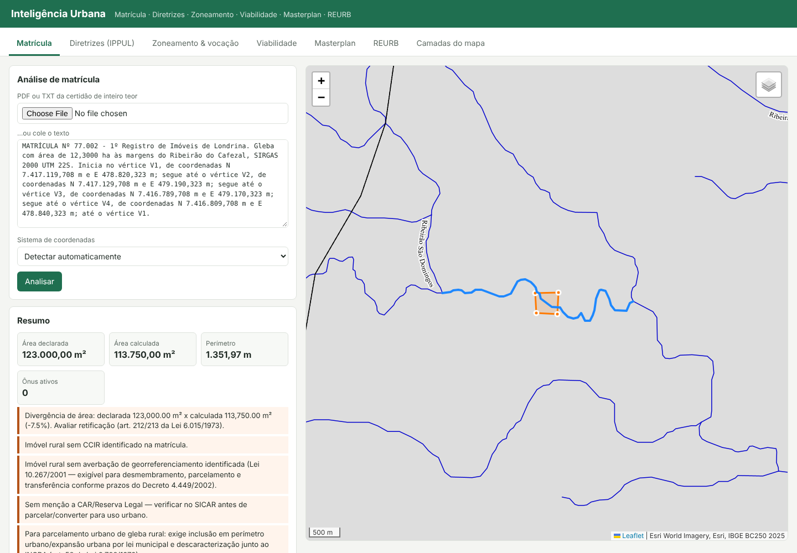

# Inteligência Urbana

Ferramenta de apoio à **incorporação e ao desenvolvimento urbano**: lê a matrícula do imóvel, interpreta as
diretrizes de parcelamento (IPPUL/Londrina), cruza com o zoneamento municipal, sugere a vocação da área, gera
um **masterplan preliminar** e calcula a **viabilidade** (VGV, CUB, ROI, TIR, VPL, exposição de caixa). Exporta
perímetros, confrontações e masterplan para o **Google Earth** (KML/KMZ).

Municípios iniciais: **Londrina, Cambé, Rolândia e Ibiporã** (PR). Outros entram com um arquivo YAML.



## Analisador de matrícula

Menu próprio (Dashboard, Nova análise, Matrículas analisadas, Histórico registral, Ônus e restrições, Análise de
riscos, Relatórios, Configurações). Recebe PDF (com texto ou digitalizado) ou imagens JPG/PNG, lê cada página
(texto do PDF ou OCR com confiança), separa registros e averbações e mostra cada informação com página, ato e trecho
original, lado a lado com o documento. Arquitetura, regras de confiabilidade e fases em
[docs/ANALISADOR.md](docs/ANALISADOR.md).

## Passo a passo (aba "Novo estudo")

1. **Matrícula** (obrigatória): o PDF é lido (com OCR se for escaneado), analisado e o imóvel é localizado e
   contornado no mapa. A etapa só termina com o contorno pronto; ajustes de posição ficam disponíveis ali.
2. **Consulta de Parcelamento do Solo (IPPUL)**: liberada após a matrícula. O croqui é encaixado sobre o imóvel
   e as diretrizes (vias previstas, fundo de vale, áreas públicas, zona) são aplicadas.
3. **Masterplan**: gerado automaticamente com as diretrizes e demarcado no mapa (quadras, lotes numerados com
   área, vias previstas, áreas verde e institucional, APP), com KML e atalho para a viabilidade.

### Imagem de apresentação

O masterplan pode ser exportado como prancha em PNG (2400 px), desenhada sobre o satélite: vias em asfalto com
calçadas, lotes com divisas, praças arborizadas, áreas institucionais, APP sobre a mata, quadras identificadas,
legenda, quadro de áreas, norte e escala.



## Módulos

| Módulo | O que faz |
|---|---|
| `documentos/matricula.py` | Nº da matrícula, cartório, lote/quadra, CCIR/CAR e área declarada (m², ha, alqueire paulista). Lê os atos **R/AV**, classifica 30 tipos e marca ônus como *ativo* ou *possivelmente cancelado*. Também lê o memorial descritivo (vértices em UTM ou lat/long, azimutes/rumos, distâncias, confrontantes), confere área declarada × calculada e o fechamento da poligonal |
| `documentos/consulta_ippul.py` | Diretrizes de parcelamento: zonas, macrozona, lote mínimo, testada, % de áreas públicas, caixas de via, faixas de fundo de vale, trechos por tema (viário, ambiental, infraestrutura, licenciamento) |
| `geo/` | SIRGAS 2000 / UTM 22S (EPSG:31982), SAD-69 e lat/long; DMS; rumo → azimute; área, perímetro e fechamento; KML/KMZ com vértices e confrontações |
| `geo/camadas_oficiais.py` | Camadas oficiais no mapa: CAR/SICAR, hidrografia e limites municipais do IBGE (BC250 2025). Cruza a matrícula com os CARs que a sobrepõem e com os cursos d'água próximos; os córregos encontrados alimentam a APP do masterplan |
| `legislacao/federal.py` | Lei 6.766/79 (lote 125 m², testada 5 m, faixa de 15 m, declividade de 30%), APP do Código Florestal, checklists de loteamento/incorporação e classificação de **REURB** (Lei 13.465/17) |
| `legislacao/zoneamento.py` + `dados/zoneamento/*.yaml` | Parâmetros por zona (CA, TO, permeabilidade, gabarito, lote mínimo, recuos) e análise de **vocação** (loteamento, condomínio de lotes, vertical, misto, logístico, ZEIS) |
| `viabilidade/loteamento.py` | Quadro de áreas, nº de lotes, permuta, VGV, infraestrutura, comissão, impostos e fluxo mensal com vendas parceladas |
| `viabilidade/incorporacao.py` | Área computável/construída/privativa a partir do CA, custo pelo **CUB** × fator, RET (4%), permuta, fluxo com repasse nas chaves |
| `masterplan/gerador.py` | Traçado ortogonal com vias, quadras e lotes, desconto de APP de córregos, alocação de verde e institucional, render **SVG** e GeoJSON/KML |
| `api/main.py` + `web/index.html` | API FastAPI (`/docs`) e interface web com mapa satélite |

## Mapa

- Fundo: satélite Esri ou OpenStreetMap, com camadas de nomes/limites e ruas.
- Camadas oficiais (liga/desliga no canto do mapa): CAR, cursos d'água, massas d'água, limites municipais.
- Clique no mapa para ver coordenadas, links para **Street View**, Google Maps e Google Earth, e os dados das
  camadas ligadas (ex.: código, área e situação do CAR).
- Aba **Camadas do mapa**: adicione KML/GeoJSON próprios (SIGEF, lotes da prefeitura, levantamentos) ou
  qualquer serviço WMS (geoportais municipais, INCRA).
- Na matrícula: **Street View**, **CAR sobrepostos** e **Córregos próximos (IBGE)**. Os córregos podem ir direto
  para o masterplan como APP.



### SICAR e segurança TLS

O servidor do SICAR só aceita troca de chaves RSA no TLS 1.2, sem *forward secrecy*. O Chrome atual e o OpenSSL 3
recusam essa configuração. Por isso o CAR passa por um proxy da API (`/api/proxy/car-wms` e `/api/proxy/car-wfs`),
restrito aos endereços oficiais e que nunca aceita uma URL vinda do cliente. Esse proxy aceita as suítes RSA
**somente** para `geoserver.car.gov.br` (`HOSTS_TLS_LEGADO` em `geo/camadas_oficiais.py`). A mudança foi autorizada
pelo responsável do projeto em 12/11/2026. A verificação de certificado e de hostname continua ativa, e um teste
garante que nenhum outro host recebe essa exceção.

## Como rodar

```bash
pip install -e ".[dev]"
```

```bash
uvicorn inteligencia_urbana.api.main:app --reload
```

Abra http://localhost:8000. A documentação da API fica em http://localhost:8000/docs.

```bash
pytest
```

## Deploy na Vercel

O repositório já está pronto para a Vercel:

- `api/index.py`: ponto de entrada (função Python que expõe o `app` FastAPI)
- `vercel.json`: todas as rotas vão para a função; região **gru1 (São Paulo)**, tempo máximo de 60 s
  (o SICAR pode demorar) e inclusão das pastas `src/` e `web/` no pacote
- `requirements.txt`: dependências de produção (≈ 194 MB instaladas, abaixo do limite de 250 MB)
- `.vercelignore`: deixa testes e documentação fora do deploy

Para conectar:

1. Em vercel.com, clique em **Add New → Project** e importe `eaumbel/inteligencia_urbana`.
2. Em **Framework Preset**, escolha **Other**. Não é preciso comando de build nem variáveis de ambiente.
3. Clique em **Deploy**. A cada push no branch de produção a Vercel publica de novo; nos demais branches ela gera
   uma URL de prévia.

### Publicar em uma subpasta de outro domínio (ex.: eaumbel.com.br/incorporacao)

A interface usa apenas caminhos relativos (`api/...`), então o app funciona em qualquer subpasta. O site do
domínio principal só precisa repassar `/incorporacao/*` para `https://inteligencia-urbana.vercel.app/*`.
Se o domínio principal também estiver na Vercel, basta incluir no `vercel.json` **daquele** projeto:

```json
{
  "redirects": [{ "source": "/incorporacao", "destination": "/incorporacao/", "permanent": true }],
  "rewrites": [{ "source": "/incorporacao/:path*", "destination": "https://inteligencia-urbana.vercel.app/:path*" }]
}
```

## Avisos importantes

- **Zoneamento:** os YAML de cada cidade trazem a estrutura completa, mas os **índices são ilustrativos**
  (`validado: false`). Antes de usar o estudo para decidir, substitua-os pelos da lei vigente e do mapa oficial.
- **CUB:** não é fixado no código. Informe o valor do mês (Sinduscon-PR, padrão do projeto).
- **Leitura de documentos:** é heurística. PDFs são lidos no navegador; páginas escaneadas passam por OCR (Tesseract.js, cerca de 10 s por página). Sempre confira números e nomes com a certidão original.
  O resultado apoia a due diligence e **não substitui** a leitura da certidão por profissional habilitado.
- **Masterplan:** é um estudo de massa. Não considera topografia nem drenagem.

Veja o [roadmap](docs/ROADMAP.md).
